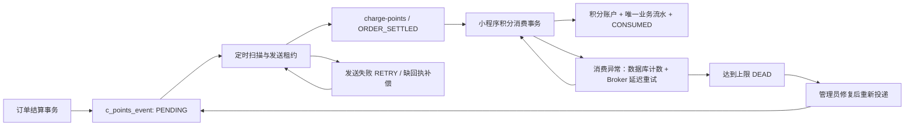

# 积分消息链路：RocketMQ 接入与迁移

当前积分链路使用 RocketMQ 4.9.7 原生 Java 客户端，生产者位于运营服务，消费者位于小程序服务。数据库 Outbox、积分流水和人工重投接口继续复用。

## 处理流程



消息体只携带事件 ID，消息 Key 也为事件 ID。消费端从数据库核对订单归属并计算积分，不接受消息指定会员、金额或积分。积分账户、唯一业务键 `ORDER:<orderId>` 的流水和消费回执在同一事务内提交。重复消息和自动/手动领取并发由业务幂等保护。

生产者只在同步发送返回 `SEND_OK` 后将事件标记为 `SENT`；消费事务完成后才是 `CONSUMED`。发送返回之前若已消费，生产者的条件更新不会覆盖消费回执。发送失败由数据库退避重试；发送超时或缺失回执可能导致重复投递。

消费异常返回 `RECONSUME_LATER`，指定延迟等级 2（Broker 默认 5 秒）。失败计数单独提交，避免随积分事务回滚；达到上限时数据库状态变为 `DEAD`。无法匹配事件或本次达到失败上限的消息送至消费组死信 Topic；已终止事件的迟到消息直接确认。数据库不可用时保留消息重试，业务上限由数据库控制。消费者启动失败每 10 秒重试，新消费组从最早可用位点开始消费。

## 本地部署

从仓库根目录，在 Windows PowerShell 中重新编译并复制两个更新模块：

```powershell
Set-Location .\yuneng-cloud
mvn -pl hcp-modules/hcp-operator,hcp-modules/hcp-mp -am package -DskipTests
if ($LASTEXITCODE -ne 0) { throw 'Backend build failed' }
Copy-Item .\hcp-modules\hcp-operator\target\hcp-operator.jar .\docker\hcp\modules\operator\jar\hcp-operator.jar
Copy-Item .\hcp-modules\hcp-mp\target\hcp-mp.jar .\docker\hcp\modules\mp\jar\hcp-mp.jar
Set-Location .\docker
.\start-local.ps1 -BuildImages
```

该操作依赖本地部署的其他模块 JAR 已经准备完成。Linux 完整部署继续使用 `prepare-linux.sh` 编译和复制 JAR，再执行 `start-linux.sh`。`-BuildImages` 构建 Docker 镜像，不会执行 Maven 编译。

Compose 启动顺序：

1. `hcp-rocketmq-permissions` 使用 root 将三个命名卷根目录归属交给镜像内的 `rocketmq` 用户，随后退出；不接入网络。
2. NameServer `172.18.0.20:9876` 启动并通过端口检查。
3. Broker `172.18.0.19:10911` 启动，`mqadmin brokerStatus` 健康检查通过。
4. `hcp-rocketmq-init` 在 `172.18.0.22` 创建 `charge-points` Topic（4 个读/写队列），成功后退出。
5. 运营服务、小程序服务在 Topic 初始化成功后启动。

Broker 使用同步刷盘、单主节点、Docker 命名卷。固定地址需要与 `broker.conf`、启动脚本和 Compose 一起维护。服务端口只用于 Docker 内网，宿主机直接运行 Java 服务需要另行配置可达地址。Broker JVM 设置 `-XX:-UseContainerSupport`，用于兼容镜像内旧 JDK 与当前 Docker Desktop 的 cgroup 环境，同时显式限制 Java 堆。

配置项、默认值及后台接口见根目录 README 的“积分消息链路”。更换 Topic 时必须先创建对应 Topic，再同步修改两个服务的配置。

## 从旧消息队列切换

先停止产生新的结算流量，再部署上述版本。`c_points_event` 的结构和业务状态保持兼容，不需要清空数据库：

| 原有状态 | 切换后的处理 |
| --- | --- |
| PENDING / RETRY | 到期扫描后通过 RocketMQ 发送 |
| PUBLISHING | 原有租约到期后重新认领 |
| SENT | 等待消费回执；超时后通过 RocketMQ 补发 |
| CONSUMED | 保留积分和回执，不重复发放 |
| DEAD | 管理员核查修复后人工重新投递 |

新链路验收通过后停止旧容器：`docker stop hcp-rabbitmq`。旧容器和 `docker/rabbitmq/data` 保留用于回查；新版本不再使用原交换机、队列或 `spring.rabbitmq.*` 配置。

## 运行检查与排错

在 `yuneng-cloud/docker` 下运行：

```powershell
docker compose ps -a
docker logs --tail 80 hcp-rocketmq-broker
docker logs --tail 80 hcp-mp
docker exec hcp-rocketmq-broker sh mqadmin topicStatus -n hcp-rocketmq-namesrv:9876 -t charge-points
docker exec hcp-rocketmq-broker sh mqadmin consumerProgress -n hcp-rocketmq-namesrv:9876 -g charge-points-consumer
```

Broker 启动失败且无标准输出时，检查卷目录所有权及权限初始化容器的退出状态。Broker 启动成功但消费拉取报告 `StoreUtil` 初始化失败时，核对 Compose 中的 JVM 兼容参数是否已经生效，重新创建 Broker 后复查消费进度。内部详细日志位于 Broker 的 `/home/rocketmq/logs/rocketmqlogs/`；应用内客户端日志位于 `/root/logs/rocketmqlogs/`。

积分状态以数据库回执为准，不能仅凭 Broker 健康或 `SENT` 判断到账。需要人工修复的事件可在“运营管理 → 充电订单 → 积分发放监控”处理。不要通过删除卷或数据库来重试启动。

## 验证

在本地演示环境串行运行以下脚本，需要 Node.js 18+：

```powershell
node test-points-mq.cjs
node test-points-ops.cjs
```

第一份覆盖并发结算、重复消息、零积分、Broker 停机恢复、消费者停机与缺回执补偿、消费异常回滚、发布租约恢复；第二份覆盖自动/手动领取并发、补偿上限、消费失败上限、后台按钮重投和已到账禁止重投。脚本创建临时数据，结束时清理并恢复服务；第二份还需要 Playwright 与 Edge。

2026-10-22 在本机 Windows + Docker Desktop 实测：

| 检查 | 结果 |
| --- | --- |
| 运营、小程序模块及依赖 Maven 打包 | 15 个构建模块成功；跳过单元测试，业务行为由下列集成脚本验证 |
| `test-points-mq.cjs` | 7 项通过；所有奖励合计恰好 40 分，重复投递不增加积分 |
| `test-points-ops.cjs` | 4 项通过；包含真实后台弹窗、按钮确认、失败上限和人工恢复，浏览器无脚本错误 |
| Compose 配置、PowerShell/Bash 启动脚本语法 | 通过 |
| 打包产物依赖核查 | 包含 `rocketmq-client-4.9.7`，无旧 RabbitMQ/AMQP 客户端与配置类 |

测试过程中发现并修复了新命名卷权限、初始化容器动态 IP 与业务静态 IP 冲突、旧 JDK 在当前容器环境下的 `StoreUtil` 初始化失败。修复后完整重跑两份集成验收均通过。旧 RabbitMQ 容器在验收结束后停止，保留容器与运行数据。

单 Broker 方案未覆盖主从切换、高可用、ACL/TLS、生产负载与全新 Linux 虚拟机部署。
